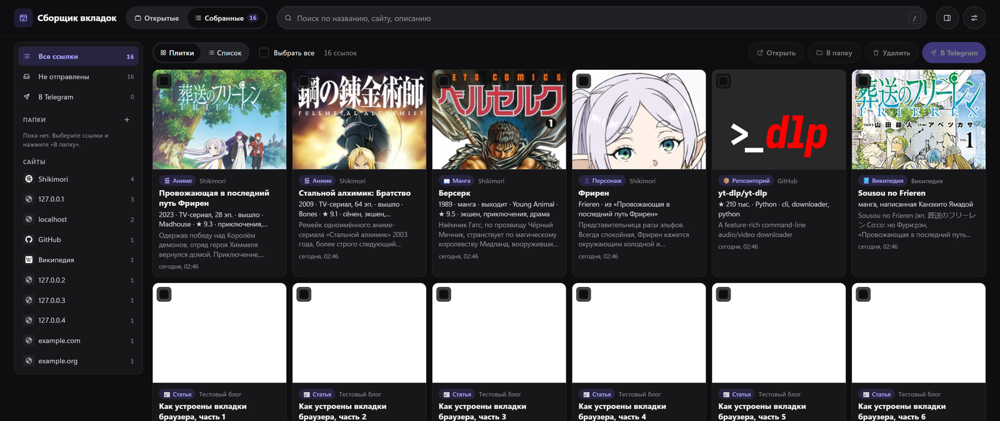
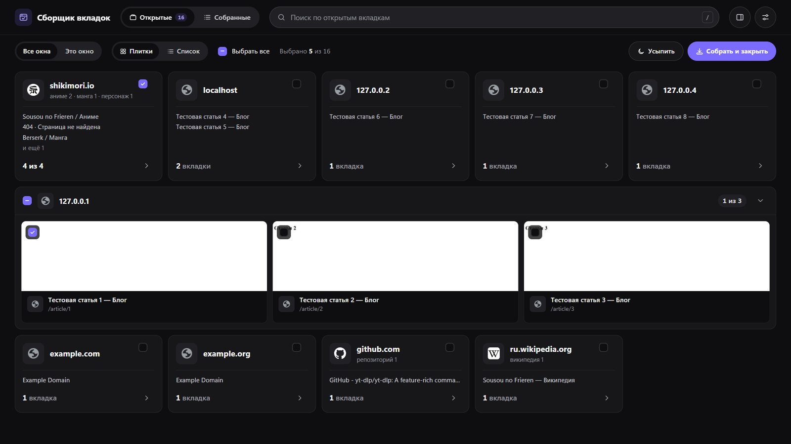
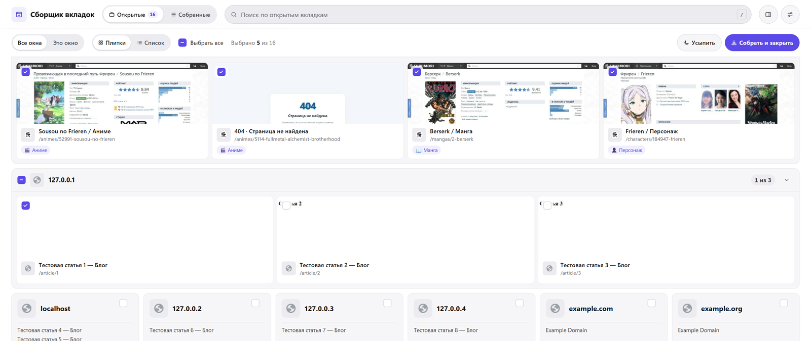
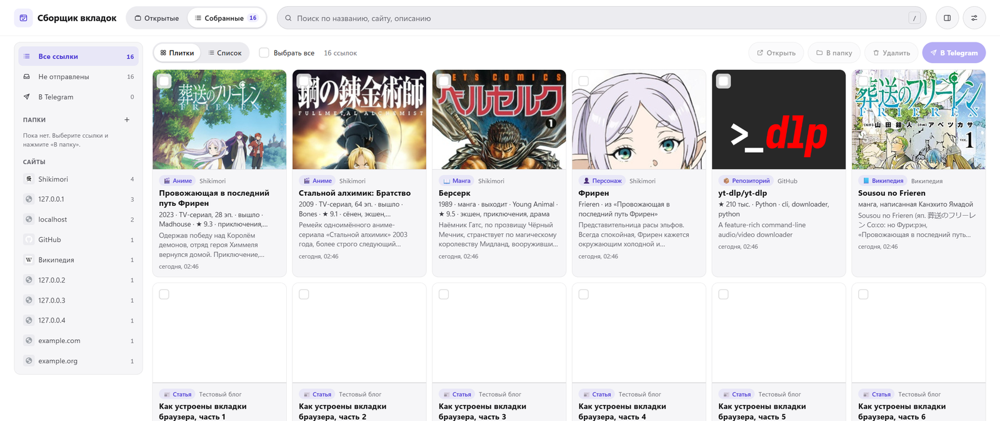
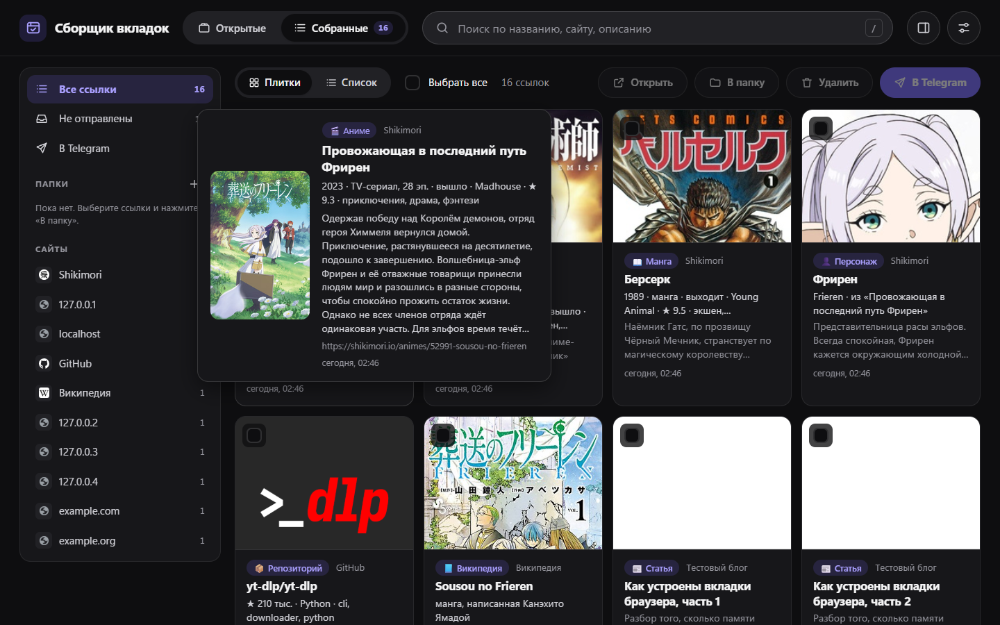
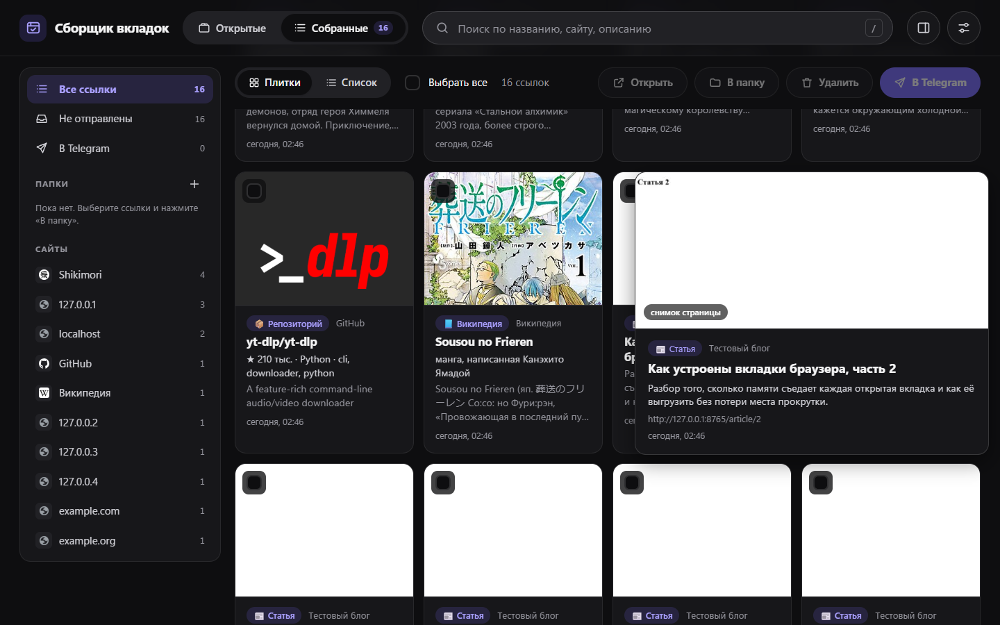
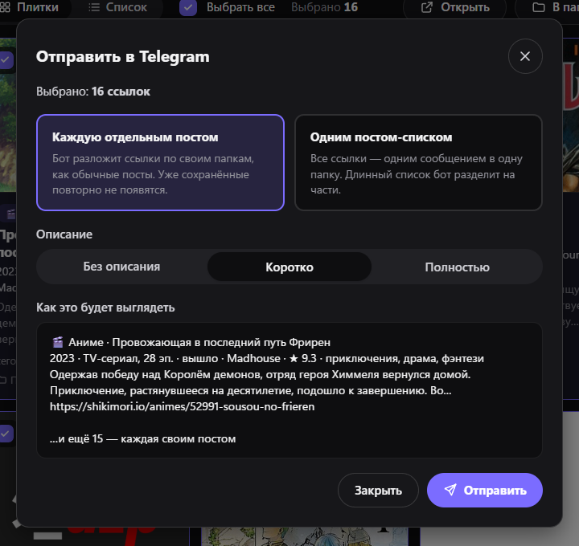
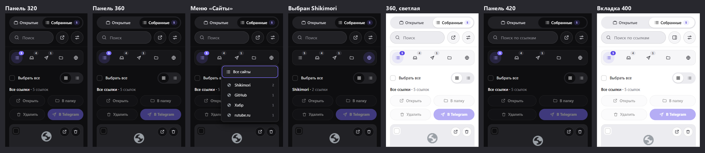
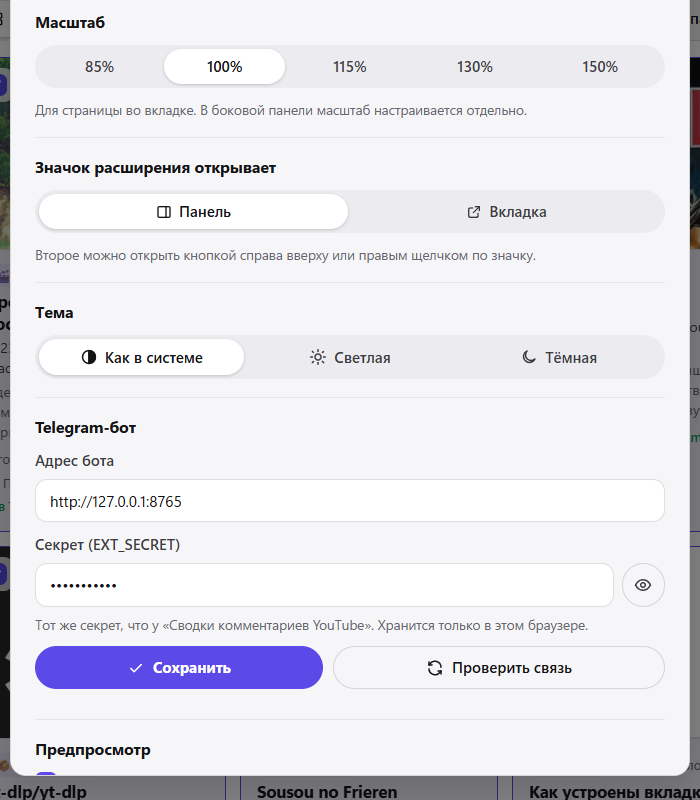

# Сборщик вкладок

Расширение для Chrome для тех, у кого открыто 100+ вкладок. Оно собирает вкладки в один аккуратный список, усыпляет те, что пока нужны, а выбранные ссылки с описанием отправляет в ваш Telegram-бот-архив одним нажатием.

- **Сотни вкладок — в один список.** Вкладки сгруппированы по сайтам. Отмечаете нужные и нажимаете «Собрать и закрыть» или «Усыпить»: вкладка остаётся на месте, но перестаёт есть память.
- **Понятно, что за ссылки.** Расширение само узнаёт страницы: аниме, мангу или персонажа на Shikimori, видео на YouTube, репозиторий на GitHub, статью в Википедии или на Хабре, поиск в Google. Подтягивает название, год, оценку, жанры, описание и постер.
- **В Telegram — красиво.** Каждая ссылка отдельным постом (бот разложит их по папкам) или все одним постом-списком.

**Бесплатно.** Данные о страницах берутся из открытых API сайтов, сортировка в Telegram — бесплатный Groq внутри вашего бота. Список хранится только в вашем браузере.



## Оглавление

- [Установка](#установка)
- [Открытые вкладки](#открытые-вкладки--собрать-или-усыпить)
- [Собранные](#собранные--галерея-папки-поиск)
- [Предпросмотр при наведении](#предпросмотр-при-наведении)
- [В Telegram](#в-telegram)
- [Боковая панель и узкий экран](#боковая-панель-и-узкий-экран)
- [Настройки](#настройки)
- [Что распознаётся](#что-распознаётся)
- [Приватность и бережность](#приватность-и-бережность)
- [Для разработки](#для-разработки)

## Установка

1. Скачайте папку проекта (`git clone https://github.com/ShurikPozd/tab-collector` или «Code → Download ZIP»).
2. Откройте `chrome://extensions`, включите «Режим разработчика» справа вверху.
3. «Загрузить распакованное» → выберите папку проекта.
4. Нажмите значок расширения — откроется боковая панель. Для отправки в Telegram впишите в настройках (значок ⚙ справа вверху) секрет бота — тот же `EXT_SECRET`, что у «Сводки комментариев YouTube».

Дальше расширение **обновляется само**: раз в 30 секунд оно сверяет версию в `manifest.json` в папке и перезапускается, если она изменилась. Жать «Обновить» на `chrome://extensions` не нужно.

> Секрет можно положить и в файл: скопируйте `local-config.example.js` в `local-config.js` и впишите его туда. Этот файл в git не попадает.

## Открытые вкладки — собрать или усыпить

Все открытые вкладки, сгруппированные по сайтам: крупная плитка на сайт, на ней число вкладок, типы страниц («аниме 33 · манга 2») и первые заголовки.



Нажмите на сайт — он раскроется на всю ширину, его вкладки тоже станут плитками. Если вы уже заходили на вкладку, на плитке будет снимок страницы, так что вкладку легко узнать.



- **«Собрать и закрыть»** — вкладки сохраняются в список (адрес, название, описание, место прокрутки) и закрываются. Сразу после этого можно нажать «Вернуть».
- **«Усыпить»** — вкладки остаются в окне, но выгружаются из памяти и загрузятся, когда вы на них перейдёте. Вкладки, где играет звук или есть недописанный текст, не трогаются.
- **«Закрыть дубли»** — если одна и та же страница открыта несколько раз, кнопка оставит по одной копии (закреплённую, активную или ту, где вы были последним).
- **Автоусыпление** (в настройках): вкладки, к которым вы не возвращались 1, 3, 12 часов или сутки, усыпляются сами.
- Закреплённые вкладки, служебные страницы Chrome и вкладка, с которой вы открыли сборщик, не трогаются никогда.
- Быстро, без открытия страницы: правый щелчок по значку → «Собрать вкладки этого сайта» или «Усыпить все вкладки окна».
- **Текущую вкладку — сразу в Telegram:** кнопка со «самолётиком» в шапке сборщика, правый щелчок по значку → «Отправить эту вкладку в Telegram», правый щелчок по странице или ссылке → «Отправить … в Telegram», или клавиши `Alt+Shift+G` (поменять — `chrome://extensions/shortcuts`). На значке: «…» — отправляется, «✓» — в чате бота, «!» — не получилось (причина — в уведомлении). Ссылка появится и в «Собранных» с отметкой «В Telegram».

## Собранные — галерея, папки, поиск

Собранные ссылки лежат галереей: сверху постер или снимок страницы, ниже тип, название, год, оценка и описание. Есть и обычный список: переключатель «Плитки / Список».



- **Группы:** по сайтам (как в «Открытых»; внутри одного сайта — по типам: аниме, манга, персонажи), по сборам — что собрано за один раз («Собрано сегодня, 14:57 · 38 ссылок»), или без групп. У группы — флажок «выбрать всю», чтобы одним нажатием отправить её в Telegram или положить в папку, и сворачивание.
- **Разделы:** все ссылки, «Не отправлены», «В Telegram», свои папки, сайты с разбивкой по типам (у Shikimori: аниме, манга, персонажи).
- **Отметки** «Хочу», «Смотрю / Читаю», «Посмотрел / Прочитал» — у каждой ссылки (кнопка ☆) или сразу у выбранных («Отметить»); слева появляются разделы по отметкам.
- **Поиск** по названию, сайту, описанию (клавиша `/`).
- **Дубли склеиваются:** `shikimori.one/animes/52991-frieren` и `/animes/52991` — одна ссылка, метки вида `utm_*` не в счёт. При этом разные страницы (письма в Gmail, разные поиски) не слипаются.
- **Открыть:** ссылка откроется справа от текущей вкладки, на том же месте прокрутки. Если открываете много ссылок сразу, все, кроме первой, откроются усыплёнными.
- **Удалить** можно с «Вернуть»; есть резервная копия всего списка в файл.

## Предпросмотр при наведении

Задержите мышь на ссылке на полсекунды — появится большая карточка с постером или снимком страницы и полным описанием.

| Аниме с Shikimori | Обычный сайт — снимок страницы |
|---|---|
|  |  |

Снимок видимой части страницы расширение делает само, когда вы переходите на вкладку, и хранит только в этом браузере. Банки, почту, мессенджеры и страницы с полем пароля оно не снимает. В настройках снимки можно выключить или удалить все сразу.

## В Telegram

Выберите ссылки → «В Telegram». Ссылки уходят в ваш бот-архив [@SaveandSort_bot](https://github.com/ShurikPozd/tg-saver-bot-cloud).



- **Каждую отдельным постом** — бот разложит ссылки по своим папкам, как обычные посты. Уже сохранённые повторно не появятся.
- **Одним постом-списком** — все ссылки одним сообщением. Длинный список бот сам разделит на части по 4096 символов.
- **Описание:** без описания, коротко или полностью. Предпросмотр сразу показывает, как будет выглядеть сообщение.
- Бот бережёт бесплатные лимиты ИИ и может попросить подождать. Тогда расширение ждёт само, с отсчётом, а если ждать долго — останавливается: оставшиеся ссылки лежат в «Не отправлены». Отправленные отмечаются «✓ в Telegram · папка».

## Боковая панель и узкий экран

Значок открывает сборщик сбоку, рядом с любой страницей, как у «Сводки комментариев YouTube». Кнопка справа вверху переносит его во вкладку на весь экран и обратно.

На узком экране разделы — одна строка круглых значков с числами, а папки и сайты открываются меню:



## Настройки



- **Масштаб** 85–150 %, отдельно для панели и для вкладки: на большом мониторе можно крупнее, в панели — мельче.
- **Значок открывает** боковую панель или вкладку.
- **Тема:** как в системе, светлая или тёмная.
- **Telegram-бот:** адрес и секрет, кнопка «Проверить связь».
- **Предпросмотр:** снимки страниц вкл/выкл, «Удалить все снимки».
- **Резервная копия:** раз в сутки (и после крупного сбора) список сам уходит файлом в ваш Telegram-бот; можно отправить по кнопке, сохранить в файл и загрузить обратно (в том числе `.json.gz` из Telegram). Загрузка ничего не удаляет, только добавляет недостающее.

## Что распознаётся

| Сайт | Что видно |
|---|---|
| **Shikimori** (`.one`, `.io`, зеркала) | аниме, манга, ранобэ, персонаж, человек: русское название, год, тип и эпизоды/главы, статус, студия, оценка, жанры, описание, постер |
| **MyAnimeList**, **AniList** | то же по открытым API (Jikan, GraphQL) |
| **YouTube** | видео, Shorts, плейлист, канал: название, автор, обложка |
| **GitHub** | репозиторий (звёзды, язык, темы), issue, pull request, профиль |
| **Википедия** | статья: краткое описание и картинка |
| **Хабр** | статья или новость: автор, время чтения |
| **AniLibria / AniLiberty** (`anilibria.top`, `aniliberty.top`, зеркала) | аниме и отдельная серия: название, сезон и год, тип и число эпизодов, статус, оценка Shikimori, жанры, описание, постер (открытое API) |
| **MangaLib** | манга, манхва, маньхуа: название, год, тип и главы, статус, автор, жанры, описание, обложка (открытое API; тайтлы 18+ — по метатегам страницы) |
| **Webtoons** | вебтун и его эпизод: название, автор, жанр, просмотры и подписчики, описание, обложка |
| **Rutube** | видео, Shorts, канал: название, канал, длительность, просмотры, обложка |
| **hh.ru** (и региональные `spb.hh.ru` и т.п.) | вакансия: должность, компания, зарплата, город, удалёнка, опыт, описание |
| **Ozon** | товар: тип «Товар» и то, что прочитано с открытой вкладки (гостю Ozon страницу не отдаёт, поэтому повторно не запрашивается) |
| **Google, Яндекс, Bing, DuckDuckGo** | поиск — с текстом запроса |
| **Любой сайт** | название, описание и картинка из метатегов страницы; тип (статья, видео, товар) по `og:type` |

## Приватность и бережность

- Список ссылок, снимки и настройки хранятся только в вашем браузере (`chrome.storage`, IndexedDB). Наружу уходят только ссылки, которые вы сами отправили в свой бот.
- Страницы для описаний запрашиваются **без ваших куки**, как гостем. Локальные адреса, адреса частных сетей и ссылки вида «выйти», «отписаться», «подтвердить» не запрашиваются вовсе.
- Вкладка закрывается только после того, как она записана в список. Удаление можно вернуть, загрузка резервной копии ничего не удаляет.
- В режиме инкогнито расширение не работает.

## Для разработки

```
npm test
```

- `tests/run.mjs` — распознавание адресов и склейка дублей, разбор ответов API, текст сообщений (как у бота), пачки ≤64 КБ.
- `tests/store.mjs` — хранилище на подменённом `chrome.storage`: перенос старого формата, запись только изменившегося, удаление и «Вернуть», импорт.
- `tests/check.mjs` — все модули разбираются как ESM, имена в import/export сходятся.

| Файл | Что делает |
|---|---|
| `core/url.js` | распознавание адресов: сайт, тип страницы, ключ для склейки дублей |
| `core/enrich.js` | подробности из API сайтов и метатегов (разбор ответов — чистые функции) |
| `core/format.js` | текст ссылки и списка (как у бота), тело запроса, пачки ≤64 КБ |
| `core/store.js` | хранилище: каждая ссылка — ключ `it:<id>`, порядок — `order`; запись под общим замком |
| `core/collect.js` | сбор вкладок (метатеги, прокрутка) и «Усыпить» с проверкой черновиков |
| `core/bot.js` | `POST /api/save-links` с `X-Sec-Token`, ожидание при лимитах, проверка связи |
| `core/shots.js` | снимки страниц для предпросмотра (IndexedDB, ≤640 px) |
| `background.js` | значок и боковая панель, меню значка, открытие ссылок, снимки, автообновление |
| `app/` | страница сборщика (вкладка и панель): «Открытые», «Собранные», отправка, настройки |

Отправка в Telegram работает через эндпоинт `POST /api/save-links` бота [tg-saver-bot-cloud](https://github.com/ShurikPozd/tg-saver-bot-cloud). Формат запроса описан в `core/format.js`.
